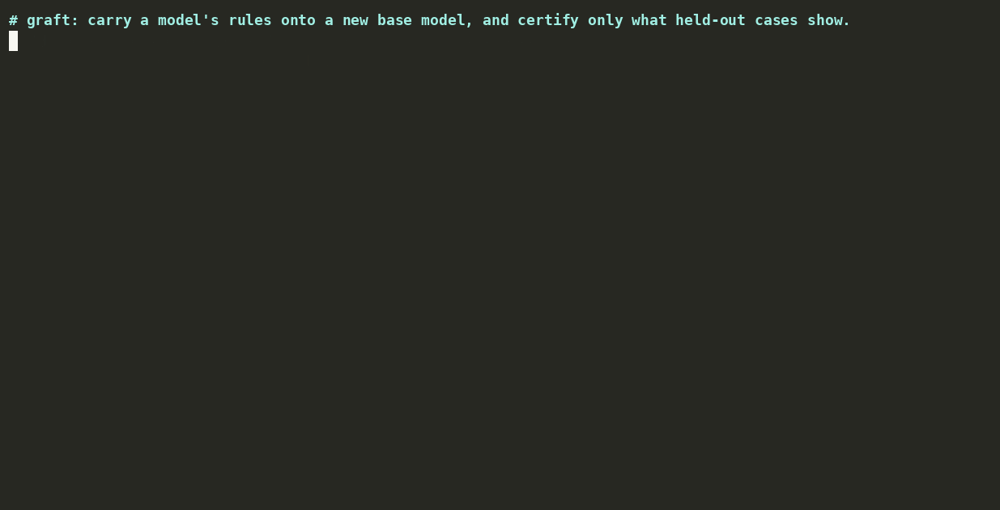

<h1 align="center">
  
</h1>

<p align="center">
  
  
  
  <a href="#license"></a>
  <a href="https://github.com/csabesz1130/graft.sh/actions/workflows/ci.yml"></a>
</p>

<p align="center"><b>Git rebase for model behavior. Move to a new base model and keep what your old one got right.</b></p>

<p align="center">
  
</p>

<p align="center"><sub>Real commands on two saved runs (<a href="docs/assets/graft-demo.mp4">MP4</a>). Training ran on a Modal L4 and is cut. The numbers are explained under <a href="#results-on-real-models">Results on real models</a>.</sub></p>

A better open-weight base model comes out every few months. Your fine-tune, your LoRA adapters and your tuned prompts belong to the old one, and none of them carry over. graft keeps what your model does right in a form that outlives any one model: a **behavioral genome** of rules, recorded requests and deterministic checks, in a folder in your own repository. When a new base arrives, `graft rebase` carries the genome onto it on your own hardware and writes a certificate of exactly what held.

```bash
curl -fsSL https://raw.githubusercontent.com/csabesz1130/graft.sh/main/install.sh | bash
```

## Try it in a minute

The repository ships an example with two scripted stand-ins for models, so the whole flow runs with no GPU. It is a simulation of the workflow, not inference.

```bash
git clone https://github.com/csabesz1130/graft.sh && cd graft.sh/examples/support-desk
python3 mock_models.py &            # an "old" model and a "new base" at one OpenAI-compatible address
graft rebase --target new-base
```

```text
genome 0d148ae2   5 rules, 52 cases
source            52/52 cases hold on prod
zero-shot         13/52 cases   1 of 5 rules hold
prompt round 1    32/52 cases   3 of 5 rules hold
prompt round 2    40/52 cases   4 of 5 rules hold
training          mock_trainer.py on .graft/grafts/new-base/0001-0d148ae2/lora/round-1/dataset.jsonl
lora round 1      52/52 cases   5 of 5 rules hold
suite arithmetic  prod 66.7%   new-base 90.0%   grafted 90.0%   (+23.3 points, p=0.0156)

Rebased prod onto new-base as a trained adapter.
certificate  .graft/grafts/new-base/0001-0d148ae2/certificate.json
```

`graft show` prints the certificate. [The example's README](examples/support-desk/README.md) walks through what happened at each step.

Package a passed run with `graft export --out verified.zip`. The [command reference](docs/cli.md#export-a-verified-run) covers portable, vLLM and Goethe exports.

## How it works

**1. Keep a genome.** A rule is one sentence plus the cases that pin it down. A case is a request and the checks its reply must pass. Counterfactual pairs put two nearly identical requests on either side of a boundary, and both sides have to come out right.

```toml
# genome/rules/refund-limit.toml
statement = "Refunds above $500 are never issued directly. Escalate them to the refunds queue."
```

```json
{"id": "refund-boundary", "pair": [
  {"messages": [{"role": "user", "content": "Refund $480 for order #2001."}],
   "verify": [{"type": "tool_call", "name": "issue_refund", "arguments": {"amount": 480}}]},
  {"messages": [{"role": "user", "content": "Refund $520 for order #2001."}],
   "verify": [{"type": "tool_call", "name": "escalate", "arguments": {"queue": "refunds"}},
              {"type": "no_tool_call", "name": "issue_refund"}]}]}
```

Checks are deterministic: text and regex matches, JSON schemas, tool calls and their arguments, or your own program. No model grades another model. `graft capture` turns recorded production traffic (a [Goethe](https://github.com/meshapplied/goethe) trace folder, or a chat fine-tuning file) into cases.

**2. Rebase.** `graft rebase --target <new-base>` climbs a ladder and stops at the first rung where every gate holds:

| Rung | What it does | Cost |
|---|---|---|
| `zero-shot` | Asks the new model as it is. Behavior that already holds needs no work | One pass over the genome |
| `prompt` | States the failing rules in the system prompt, then adds worked examples for what still fails | A few passes |
| `lora` | Trains an adapter on replies the checks accept: the new model's own where one passes, sampled attempts next, the old model's recorded reply last | GPU hours |

After every step the whole genome is checked again, so a fix for one rule cannot quietly break another. If no rung gets there, the rebase stops with the failing cases listed, as a conflict: change the genome or the settings, then `graft rebase --continue`.

**3. Read the certificate.** It names the genome by hash, both models, the graft, and every rule with its pass count. It is careful about what it claims:

- Every case in the genome is checked, and the result can be reproduced with `graft verify`.
- A share of each rule's cases is held out. No prompt example and no training row is made from them. The certificate gives an exact binomial lower bound on the pass rate for cases like them, and widens it for every time the search looked at them.
- Capability suites compare the old model, the new base and the grafted model on the same questions, so "the new base is better" and "the graft did not cost it anything" are measured numbers, with a p-value.
- It says nothing about requests unlike the genome's cases. A rule is only as well protected as its cases are varied.

## Works with

| | |
|---|---|
| Models behind an endpoint | Anything that speaks the OpenAI chat API: Goethe, vLLM, SGLang, llama.cpp, or a hosted API |
| Models as weights | Hugging Face weights loaded in process, with an optional LoRA adapter (`pip install 'graft-sh[train]'`) |
| Anything else | A program of yours that reads a request on stdin and prints a reply |
| Trainers | The built-in LoRA trainer, or any command that reads a chat fine-tuning file and writes an adapter |

Everything runs on your machines. graft sends requests only to the endpoints you name in `graft.toml`.

## Commands

```bash
graft init                          # start a genome in this folder
graft rule add <id> "<statement>"   # add a rule
graft capture goethe <traces>       # recorded traffic becomes cases
graft status                        # rules, cases, and any rebase in progress
graft check                         # does the model that has the behavior pass its own genome?
graft verify <model>                # run every gate against a model; exit 1 when one fails
graft rebase --target <model>       # carry the genome onto a new base
graft show                          # the latest certificate
graft export --format gguf ...      # one llama.cpp file with the adapter merged in (Mac, CPU, LM Studio, Ollama)
graft verify <model> --against <run or bundle>   # does this deployment still behave as certified?
graft keygen && graft sign          # sign the certificate with your Ed25519 key
graft check-certificate <bundle> --key <public key>   # deploy gate: untouched, passed, signed by a key you trust
```

`graft verify` exits non-zero when a gate fails, so it also works as a regression gate in CI for any model or prompt change. `--against` does the same for the serving side: a quantization, another engine or chat template has to pass every case the certificate counted before it ships.

## Results on real models

graft 0.1.0 was run end to end on Modal GPUs (one 24 GB L4 for the 8B runs) with the built-in trainer: replay with distillation, LoRA on attention and MLP layers, gradient checkpointing.

- **The old model**: Qwen2.5-0.5B-Instruct with a LoRA that graft itself trained on the support-desk genome's recorded replies, standing in for a company's fine-tune.
- **The genome** (`ab2750f9`): the support-desk rules with 85 cases, 30 held out. 15 of the held-out cases were written by a separate agent that saw only the five rule statements and the case format: no other case and no model output. 27 cases are left out because the old model fails them, so each rebase is held to 58 cases, 18 of them held out.

| New base | Architecture | Outcome | Genome cases | Held out | Arithmetic suite: old / new base / grafted |
|---|---|---|---|---|---|
| Qwen3-8B | dense transformer (another lab, another tokenizer) | **passed** | 58/58 | 18/18 (95% lower bound 76.6%, after 6 looks) | 63.3% / 93.3% / 96.7% (p = 0.002 against the old model) |
| Granite-4.0-H-Tiny (7B) | hybrid Mamba-2 + mixture of experts | conflict | 56/58 | 16/18: two legal cases, one of them blind | not reached |

Forgetting, on GSM8K's first 100 test problems (plain new base against the grafted one, same questions): the certified Qwen3-8B adapter scores 92 → 93 (2 gained, 1 lost); on a 20-question multiplication set it loses one answer (20 → 19). Granite-4.0-H-Tiny scored 88 → 89 (3 gained, 2 lost) with its certified adapter for the earlier 59-case genome (45/45, held out 10/10); its adapter for the final genome was not scored.

What to keep in mind when reading these numbers:
- A held-out set of 18 cases supports a modest bound: 76.6% at 95% confidence is what 18 of 18, looked at 6 times, can show.
- Between runs, people read some held-out failures and added training cases for the same rules (card numbers with leading zeros, legal notices phrased as statements, more normal-priority tickets). graft counts the times its own search consults held-out results, not the times a person does. The 15 blind cases were never used that way.
- On a 350M-parameter new base (Granite-4.0-H-350M, CPU), the same recipe could not keep the new base's arithmetic: the graft cost 7% to 23% of the suite whatever the settings, and the gate stopped it.
- Total compute for all of the above, failed attempts included: about $5 to $6 of Modal time.

### A second genome: SQL conventions

[`examples/sql-conventions`](examples/sql-conventions/) is a harder genome: five house conventions for text-to-SQL, each reply checked by executing it against a fixture database. No rebase of it passed, and that is the result:

| New base | Training cases | Passed in training | Passed held out |
|---|---|---|---|
| Qwen3-8B | 45 | 44/45 | 6/15 |
| Qwen3-14B | 45 | 45/45 | 8/15 |
| Qwen3-8B | 120 | 120/120 | 10/15 |

Every run ended in a conflict on held-out cases that differ in kind from the training cases, with training at or near 100%. The extra training cases were written without sight of the held-out cases or of any model output. On the support-desk genome, Qwen3-14B needed no training at all (59/59 from the prompt rung, held out 18/18) and was still refused: the graft cost one of 30 arithmetic answers, above the 2% gate. A 30-question suite cannot tell one fragile answer from a real loss; a larger suite with a paired test is planned.

### From a hosted model to your own, run for real

The [recipe](docs/user-guide.md#recipe-from-a-hosted-model-to-your-own) was run end to end once. Qwen3-14B behind vLLM's API, with the five support-desk rules in its system prompt, played the hosted model and answered 99 requests; `graft capture` turned the recorded traffic into cases. graft 0.1.1's capture pinned tool-call arguments and JSON exactly, free text included, so each case then got the support-desk genome's hand-written verifiers and held-out split; the recorded replies were left as they were. (From 0.2, capture's default checks pin the decisions and let free text vary: on this run's 51 tool-call and JSON cases they give the same verdict as the hand-written verifiers on every one of the new model's 204 replies across four steps.) The hosted model itself failed 20 of the 99 cases, which the rebase left out.

Rebased onto Qwen3-8B with no source model (22 minutes on one 24 GB A10G): 61 of 79 cases as it is, 69 after the prompt rung, 77 with a trained adapter. Every training case passed (51/51); 26 of 28 held-out cases did. The two that failed were written blind: a 15-digit card number given back as "ending in 005", and a $550 refund issued as two smaller ones. The rebase ended in a conflict and `graft export` refused the run, so this chain stops before serving.

A model served by vLLM from a `graft export` bundle of the certified Qwen3-8B run was checked through its OpenAI-compatible endpoint five times, over three server starts: four passes gave 58 of the 58 certified cases, one gave 57 (a held-out legal case). Served replies are not exactly repeatable from one server start to the next.

## Known limits

This is version 0.1.

- The built-in trainer and the in-process runner have been run on 7B and 8B models on one 24 GB GPU (see Results on real models) and on a toy model on CPU in the tests. Larger models and multi-GPU training are untested; expect to tune `[trainer]` settings, or plug in the trainer you already use.
- Training an adapter can cost the new base some of its general skill. A capability suite measures it and the gate stops the rebase. Replay with distillation (`[trainer] replay`) and adapting fewer layers (`targets`) reduce it. On 7B and 8B new bases no loss was measured; on a 350M new base the loss stayed between 7% and 23%.
- Models loaded in process get tool calls parsed from `<tool_call>` blocks only. For models with another tool format, serve them behind an endpoint that parses it.
- `graft capture goethe` reads chat-completions turns. Anthropic-format and Responses turns are skipped.
- A prompt graft is text for your system prompt (`graft show --graft`); graft does not serve it for you.
- A certificate's digest shows whether the file was edited after graft wrote it. It is not a signature. A trained adapter is named by the sha256 of its contents, and `graft show` and `graft verify --graft` refuse one that changed. Base weights are named by their Hugging Face revision or `config.json`, not by a hash of every weight; an endpoint is named by what it reports about itself.
- A reply recorded from production with no rule written for it is checked by similarity only, and the certificate counts such cases as weak.

## Run the Linux acceptance tests

From the repository root, use the same entry points as GitHub Actions. The server needs Python 3.11 or later with `venv`, Git, curl and a free loopback port. The runner installs into a temporary environment and exercises the installed CLI.

```sh
scripts/server-test.sh
GRAFT_TEST_PYTHON=python3.12 GRAFT_TORCH_INDEX_URL=https://download.pytorch.org/whl/cpu scripts/server-test.sh --train
```

The first command covers the core suite, a full demo rebase and its alternate endings. The second installs the training dependencies and requires all trainer tests to run. The optional Torch index selects CPU wheels on the Hetzner VM. A plain `scripts/server-test.sh --train` uses the configured default package index. Both commands return a nonzero status on a failed check.

The reported Hetzner run passed all 68 tests in training mode with CUDA unavailable. Its demo certificate recorded 52/52 passing cases and five rules holding. The baseline run skipped the four trainer tests as expected. These counts identify that run and can grow as cases are added.

## Run on a GPU with Modal

`scripts/modal_graft.py` runs any command from this checkout on a [Modal](https://modal.com) GPU, billed per second, with model weights cached on a volume between runs:

```bash
pip install modal && modal token new                      # once
modal run scripts/modal_graft.py                          # the test suite on an L4
modal volume put graft-runs ./my-project /my-project      # a project folder, model paths relative to it
GRAFT_GPU=A100-80GB modal run --detach scripts/modal_graft.py --workdir /runs/my-project --cmd "graft rebase --target new-base"
modal volume get graft-runs /my-project/.graft ./results  # the run's evals, adapters and certificate
```

## Documentation

- **[User guide](docs/user-guide.md):** build a genome, set up models, run a rebase, train, read the certificate.
- **[Genome reference](docs/genome.md):** the file format and every verifier.
- **[Command reference](docs/cli.md):** every `graft` command and option.

## Repository layout

| Path | What it is |
|------|------------|
| [`graft/`](graft/) | The `graft` command: genome, verifiers, runners, the rebase ladder, the certificate, the trainer |
| [`examples/support-desk/`](examples/support-desk/) | A complete genome with scripted stand-in models |
| [`examples/sql-conventions/`](examples/sql-conventions/) | A text-to-SQL genome checked by executing the SQL, with the results of real runs |
| [`docs/`](docs/) | User guide, genome reference and command reference |
| [`tests/`](tests/) | Unit tests and end-to-end rebases |

## License

From version 0.2.0, graft is licensed under the [Functional Source License, Version 1.1, ALv2 Future License](LICENSE) (FSL-1.1-ALv2). Each version turns into [Apache-2.0](https://www.apache.org/licenses/LICENSE-2.0) two years after its release. Versions 0.1.1 and earlier were released under Apache-2.0 and stay under it. The license of each model you rebase still applies.

### What the license allows, in plain words

This section is a summary. If it and [LICENSE](LICENSE) disagree, LICENSE is what counts.

**You may**, without asking and without paying:

- run graft at work to rebase, verify and certify your own models, including models in your company's commercial products;
- read, change and fork the code, and share your changes under the same license;
- use graft for teaching and for non-commercial research;
- use graft as a consultant or agency on a client's models, when the client uses it under this license too.

Whatever graft produces for you is yours: genomes, adapters, merged weights, certificates and export bundles are not covered by the license of graft's code.

**You may not**, without a commercial license from us, make graft available to others in a commercial product or service that substitutes for graft, or offers the same or substantially similar functionality. For example: a hosted "rebase your model" service built on graft, or a fine-tuning platform that ships graft's rebase or certificate as one of its features.

**Two years after each release**, that version is also available under Apache-2.0, with no restriction on competing use.

**A commercial license** for a use the license does not allow: contact the maintainer, [Csabesz1130 on GitHub](https://github.com/Csabesz1130).

The names "graft" and "graft.sh" are not licensed with the code; see [TRADEMARKS.md](TRADEMARKS.md). Contributions are accepted under the [contributor license agreement](CLA.md); see [CONTRIBUTING.md](CONTRIBUTING.md).
