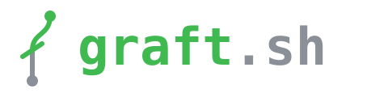

<h1 align="center">
  
</h1>

<p align="center">
  
  
  
  <a href="LICENSE"></a>
  <a href="https://github.com/csabesz1130/graft.sh/actions/workflows/ci.yml"></a>
</p>

<p align="center"><b>Git rebase for model behavior. Move to a new base model and keep what your old one got right.</b></p>

A better open-weight base model comes out every few months. Your fine-tune, your LoRA adapters and your tuned prompts belong to the old one, and none of them carry over. graft keeps what your model does right in a form that outlives any one model: a **behavioral genome** of rules, recorded requests and deterministic checks, in a folder in your own repository. When a new base arrives, `graft rebase` carries the genome onto it on your own hardware and writes a certificate of exactly what held.

```bash
curl -fsSL https://raw.githubusercontent.com/csabesz1130/graft.sh/main/install.sh | bash
```

## Try it in a minute

The repository ships an example with two scripted stand-ins for models, so the whole flow runs with no GPU. It is a simulation of the workflow, not inference.

```bash
git clone https://github.com/csabesz1130/graft.sh && cd graft.sh/examples/support-desk
python3 mock_models.py &            # an "old" model and a "new base" at one OpenAI-compatible address
graft rebase --target new-base
```

```text
genome 0d148ae2   5 rules, 52 cases
source            52/52 cases hold on prod
zero-shot         13/52 cases   1 of 5 rules hold
prompt round 1    32/52 cases   3 of 5 rules hold
prompt round 2    40/52 cases   4 of 5 rules hold
training          mock_trainer.py on .graft/grafts/new-base/0001-0d148ae2/lora/round-1/dataset.jsonl
lora round 1      52/52 cases   5 of 5 rules hold
suite arithmetic  prod 66.7%   new-base 90.0%   grafted 90.0%   (+23.3 points, p=0.0156)

Rebased prod onto new-base as a trained adapter.
certificate  .graft/grafts/new-base/0001-0d148ae2/certificate.json
```

`graft show` prints the certificate. [The example's README](examples/support-desk/README.md) walks through what happened at each step.

## How it works

**1. Keep a genome.** A rule is one sentence plus the cases that pin it down. A case is a request and the checks its reply must pass. Counterfactual pairs put two nearly identical requests on either side of a boundary, and both sides have to come out right.

```toml
# genome/rules/refund-limit.toml
statement = "Refunds above $500 are never issued directly. Escalate them to the refunds queue."
```

```json
{"id": "refund-boundary", "pair": [
  {"messages": [{"role": "user", "content": "Refund $480 for order #2001."}],
   "verify": [{"type": "tool_call", "name": "issue_refund", "arguments": {"amount": 480}}]},
  {"messages": [{"role": "user", "content": "Refund $520 for order #2001."}],
   "verify": [{"type": "tool_call", "name": "escalate", "arguments": {"queue": "refunds"}},
              {"type": "no_tool_call", "name": "issue_refund"}]}]}
```

Checks are deterministic: text and regex matches, JSON schemas, exact tool calls, or your own program. No model grades another model. `graft capture` turns recorded production traffic (a [Goethe](https://github.com/meshapplied/goethe) trace folder, or a chat fine-tuning file) into cases.

**2. Rebase.** `graft rebase --target <new-base>` climbs a ladder and stops at the first rung where every gate holds:

| Rung | What it does | Cost |
|---|---|---|
| `zero-shot` | Asks the new model as it is. Behavior that already holds needs no work | One pass over the genome |
| `prompt` | States the failing rules in the system prompt, then adds worked examples for what still fails | A few passes |
| `lora` | Trains an adapter on replies the checks accept: the new model's own where one passes, sampled attempts next, the old model's recorded reply last | GPU hours |

After every step the whole genome is checked again, so a fix for one rule cannot quietly break another. If no rung gets there, the rebase stops with the failing cases listed, as a conflict: change the genome or the settings, then `graft rebase --continue`.

**3. Read the certificate.** It names the genome by hash, both models, the graft, and every rule with its pass count. It is careful about what it claims:

- Every case in the genome is checked, and the result can be reproduced with `graft verify`.
- A share of each rule's cases is held out. No prompt example and no training row is made from them. The certificate gives an exact binomial lower bound on the pass rate for cases like them, and widens it for every time the search looked at them.
- Capability suites compare the old model, the new base and the grafted model on the same questions, so "the new base is better" and "the graft did not cost it anything" are measured numbers, with a p-value.
- It says nothing about requests unlike the genome's cases. A rule is only as well protected as its cases are varied.

## Works with

| | |
|---|---|
| Models behind an endpoint | Anything that speaks the OpenAI chat API: Goethe, vLLM, SGLang, llama.cpp, or a hosted API |
| Models as weights | Hugging Face weights loaded in process, with an optional LoRA adapter (`pip install 'graft-sh[train]'`) |
| Anything else | A program of yours that reads a request on stdin and prints a reply |
| Trainers | The built-in LoRA trainer, or any command that reads a chat fine-tuning file and writes an adapter |

Everything runs on your machines. graft sends requests only to the endpoints you name in `graft.toml`.

## Commands

```bash
graft init                          # start a genome in this folder
graft rule add <id> "<statement>"   # add a rule
graft capture goethe <traces>       # recorded traffic becomes cases
graft status                        # rules, cases, and any rebase in progress
graft check                         # does the model that has the behavior pass its own genome?
graft verify <model>                # run every gate against a model; exit 1 when one fails
graft rebase --target <model>       # carry the genome onto a new base
graft show                          # the latest certificate
```

`graft verify` exits non-zero when a gate fails, so it also works as a regression gate in CI for any model or prompt change.

## Known limits

This is version 0.1.

- The built-in trainer and the in-process runner are tested end to end on a toy model on CPU. They have not yet been run on a full-size model on GPUs; expect to tune `[trainer]` settings, or plug in the trainer you already use.
- Training an adapter can cost the new base some of its general skill. A capability suite measures it and the gate stops the rebase. Replay with distillation (`[trainer] replay`) and adapting fewer layers (`targets`) reduce it: on a CPU test rebasing onto Granite-4.0-H-350M, the arithmetic loss fell from 23% to 7% with every rule still holding, but not to the 2% gate. Expect to tune this per model.
- Models loaded in process get tool calls parsed from `<tool_call>` blocks only. For models with another tool format, serve them behind an endpoint that parses it.
- `graft capture goethe` reads chat-completions turns. Anthropic-format and Responses turns are skipped.
- A prompt graft is text for your system prompt (`graft show --graft`); graft does not serve it for you.
- A certificate's digest shows whether the file was edited after graft wrote it. It is not a signature. A trained adapter is named by the sha256 of its contents, and `graft show` and `graft verify --graft` refuse one that changed. Base weights are named by their Hugging Face revision or `config.json`, not by a hash of every weight; an endpoint is named by what it reports about itself.
- A reply recorded from production with no rule written for it is checked by similarity only, and the certificate counts such cases as weak.

## Run the Linux acceptance tests

From the repository root, use the same entry points as GitHub Actions. The server needs Python 3.11 or later with `venv`, Git, curl and a free loopback port. The runner installs into a temporary environment and exercises the installed CLI.

```sh
scripts/server-test.sh
GRAFT_TEST_PYTHON=python3.12 GRAFT_TORCH_INDEX_URL=https://download.pytorch.org/whl/cpu scripts/server-test.sh --train
```

The first command covers the core suite, a full demo rebase and its alternate endings. The second installs the training dependencies and requires all trainer tests to run. The optional Torch index selects CPU wheels on the Hetzner VM. A plain `scripts/server-test.sh --train` uses the configured default package index. Both commands return a nonzero status on a failed check.

The reported Hetzner run passed all 68 tests in training mode with CUDA unavailable. Its demo certificate recorded 52/52 passing cases and five rules holding. The baseline run skipped the four trainer tests as expected. These counts identify that run and can grow as cases are added.

## Documentation

- **[User guide](docs/user-guide.md):** build a genome, set up models, run a rebase, train, read the certificate.
- **[Genome reference](docs/genome.md):** the file format and every verifier.
- **[Command reference](docs/cli.md):** every `graft` command and option.

## Repository layout

| Path | What it is |
|------|------------|
| [`graft/`](graft/) | The `graft` command: genome, verifiers, runners, the rebase ladder, the certificate, the trainer |
| [`examples/support-desk/`](examples/support-desk/) | A complete genome with scripted stand-in models |
| [`docs/`](docs/) | User guide, genome reference and command reference |
| [`tests/`](tests/) | Unit tests and end-to-end rebases |

## License

graft is licensed under the [MIT License](LICENSE). The license of each model you rebase still applies.
